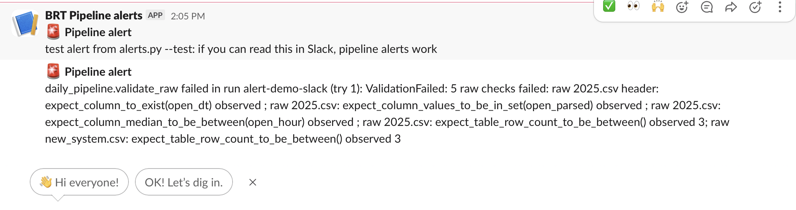
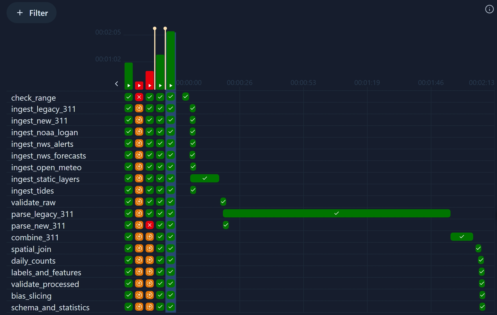
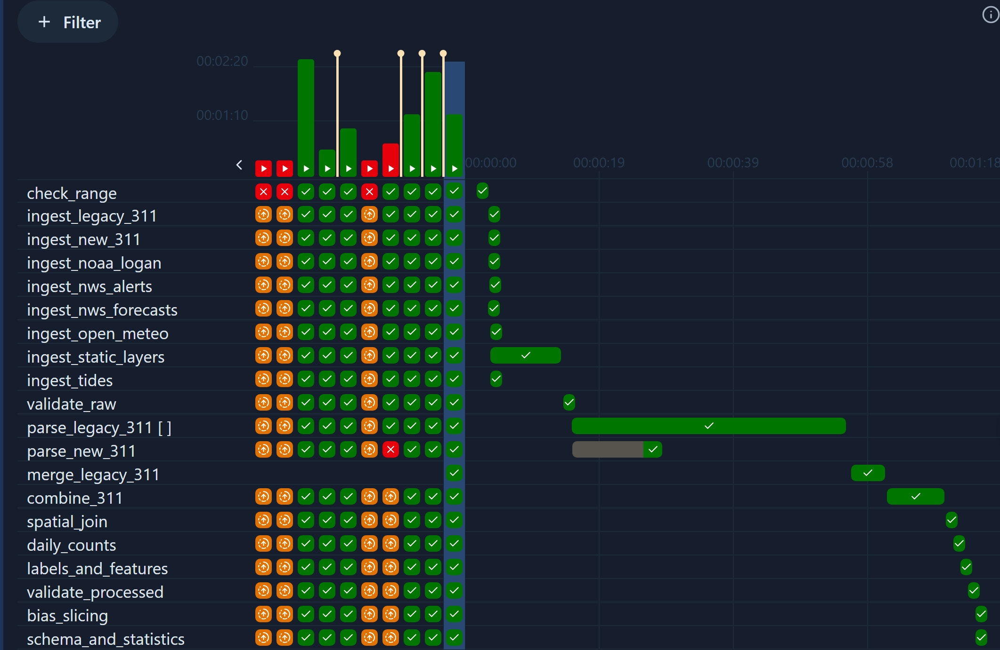

# Boston Resilience Twin

Forecasting where Boston's 311 service demand will rise next, and checking that the forecast works fairly across neighborhoods.

IE7374 MLOps, Northeastern University, Fall 2026.

## What it does

- Forecasts each evening which Boston neighborhoods will see a surge in storm-related 311 requests the next day.
- Grades every forecast against the next day's 311 reports, tracks fairness across neighborhoods, detects drift, and retrains automatically.
- Core innovation: a fairness-aware retraining controller that decides when and how to retrain, compared against fixed schedules.

## Repository structure

```
boston-resilience-twin/
├── Data-Pipeline/          Airflow DAGs, scripts, tests, DVC
├── Model-Development/      training, tuning, evaluation, bias checks, SHAP
├── Retraining-Controller/  replay environment, policy, baselines
├── Agents/                 response agent, critic, agent evals
├── Deployment/             Dockerfiles, Terraform, Cloud Run configs
├── Monitoring/             drift jobs, dashboards, alert rules
├── Frontend/               digital twin map and dashboards
├── .github/workflows/      CI/CD pipelines
├── docs/                   project status, decision records, runbook
├── docker-compose.yaml     shared Airflow stack for every component (ADR-017)
└── .env.example            local dev overrides only
```

## Setup

```bash
git clone https://github.com/PritKalariya/boston-resilience-twin.git
cd boston-resilience-twin
```

### Local Airflow stack

`docker-compose.yaml` runs Airflow 3.3.2 (LocalExecutor) with a Postgres 16 metadata database. The project uses Python 3.12 everywhere (ADR-013).

**Prerequisites**
- Docker Desktop (Windows uses the WSL 2 backend) or Docker Engine 25+ with the Compose plugin. Give Docker at least 4 GB of memory; 8 GB is better.
- Python 3.12 for running scripts and tests outside Docker (see `.python-version`).

**Start**

On Linux (the VM too), first save your user id in `.env` so the files Airflow writes to `Data-Pipeline/logs/` stay owned by you. macOS and Windows skip this step and need no `.env`:

```bash
echo "AIRFLOW_UID=$(id -u)" > .env
```

Then, on every system:

```bash
docker compose up -d --build --wait
```

The first start downloads the base images, builds the Airflow image and sets up the database. With the base image already pulled that took 1m37s on a laptop; allow a few minutes when Docker has to download it too. Later starts take under a minute. `docker compose ps -a` should show four services as `(healthy)` and `airflow-init` as `Exited (0)`.

**The Airflow image.** Every Airflow service runs `brt-airflow:local`, built from `airflow.Dockerfile`: the `apache/airflow:3.3.2-python3.12` base image (ADR-013) plus `Data-Pipeline/requirements.txt`, installed under Airflow's constraints for that image (ADR-022). The base image has none of the geo packages, so without it a task that imports geopandas, shapely, pyogrio or pyproj fails.

Rebuild it whenever `Data-Pipeline/requirements.txt` changes, including a change you pulled from `main`:

```bash
docker compose up -d --build --wait
```

DAG and script changes never need a rebuild: those files are bind-mounted, not copied into the image. A rebuild with the requirements unchanged is fully cached and takes about a second.

Open http://localhost:8080 and log in as `airflow` / `airflow`. These defaults are for your own machine only.

**Run the hello DAG.** It is a smoke test that also checks the image runs Python 3.12. New DAGs start paused, so unpause it first:

```bash
docker compose exec airflow-scheduler airflow dags unpause hello
docker compose exec airflow-scheduler airflow dags trigger hello
docker compose exec airflow-scheduler airflow dags list-runs hello
```

The run reaches `success` within a minute. You can also unpause and trigger it from the UI.

**Where things live**
- DAG files: `Data-Pipeline/dags/`. New files are picked up within 30 seconds.
- Task logs: `Data-Pipeline/logs/` (gitignored).
- Pipeline data: `Data-Pipeline/data/` (gitignored). The `daily_pipeline` DAG reads `raw/` and writes `interim/`, or `slices/<start>_<end>/` for a shorter date range. How to run it: the runbook, "Run the data pipeline DAG".

**Stop**

```bash
docker compose down      # stop; keeps the database and run history
docker compose down -v   # stop and delete the database (full reset)
```

The containers restart whenever Docker starts (for example after a reboot) until you run `docker compose down`.

**Optional overrides.** `.env` is for local development only. To change a dev default, such as the port, add the line to `.env` using the names in `.env.example`. Never commit `.env`. In Windows PowerShell 5.1, do not create `.env` with `>` or `Out-File`: they write UTF-16 and every compose command then fails.

**API keys.** Tasks that call NOAA, Census or NWS read `NOAA_CDO_TOKEN`, `CENSUS_API_KEY` and `NWS_USER_AGENT` from `.env`. Without your own keys the stack still runs, and only the tasks that need a missing key fail, naming it. How to get them: `docs/data-access.md`.

The VM gets its secrets from Secret Manager (ADR-015), set up in #20. The runbook (`docs/runbook.md`) has the operating steps and fixes for common problems.

**Tests**

```bash
docker compose run --rm --build test       # the full suite with coverage, on Python 3.12 in the Airflow image
pip install ruff==0.17.2 && ruff check .   # lint, as CI runs it
```

The test command needs Docker only, no Python on the host. It builds the Airflow image (`brt-airflow:local`; cached after the first build), prints the Python version and stops unless it is 3.12 (ADR-013), then runs every test, the DAG tests included, and prints the line coverage of each module in `Data-Pipeline/scripts/`. It fails below 70 percent (`.coveragerc`). The test container gets no `.env`, no keys and no network, and an empty folder hides `Data-Pipeline/data`, so a run on a laptop sees what CI sees. Arguments replace the full suite and go to pytest, for example `docker compose run --rm test Data-Pipeline/tests/test_dvc_push.py --no-cov`.

CI (`.github/workflows/ci.yml`) runs the same lint and test command for every pull request and every push to main. Tests may not reach the network: `Data-Pipeline/tests/conftest.py` fails any test that tries, so use fixture files or fakes.

To run the tests on the host instead, use Python 3.12 (ADR-013): the pins come from the Airflow constraints for 3.12, and on other versions the install can fail or build packages from source. Without a system 3.12, `uv venv --python 3.12 --seed .venv && source .venv/bin/activate` creates one (`.venv/` is gitignored); then `pip install -r Data-Pipeline/requirements.txt` and `python -m pytest Data-Pipeline/tests`. The DAG tests skip there, since Airflow comes only with the image.

### Versioned data (DVC)

DVC is installed by `Data-Pipeline/requirements.txt`. The remote is **`gs://boston-resilience-twin-data/dvc`**, a private bucket in project 1 (`.dvc/config`).

The pipeline's stages are in `Data-Pipeline/dvc.yaml` (ADR-024): the same steps the `daily_pipeline` DAG runs, for the full build, from the raw downloads to `processed/labels.parquet` and `processed/features.parquet`. Run DVC from `Data-Pipeline/`.

**Team members** have read and write access. Log in once per machine, then pull and check:

```bash
gcloud auth application-default login
cd Data-Pipeline
dvc pull
dvc repro      # "Data and pipelines are up to date." when the pull matches dvc.lock
```

**Without access**, for example a grader, skip `dvc pull`. `dvc repro` then rebuilds every stage from the public sources, about 2 GB of downloads. It needs Python 3.12 with `Data-Pipeline/requirements.txt` (Tests, below) and a free NOAA CDO token in `NOAA_CDO_TOKEN` (`docs/data-access.md`):

```bash
cd Data-Pipeline
export NOAA_CDO_TOKEN='...'
dvc repro
```

Pushing is skipped without access: `python Data-Pipeline/scripts/dvc_push.py` logs `dvc push skipped: ...` and exits 0, and the data stays in the local DVC cache.

`Data-Pipeline/dvc.yaml` is generated from the DAG's step table (`pipeline_steps.step_plan`), so a step is defined once. After changing a step, run `python Data-Pipeline/scripts/dvc_stages.py`; a test fails while the file is stale.

The runbook ("Versioned data (DVC)") has the checks and fixes.

### Pipeline alerts

When a pipeline task fails for good, its failure callback sends one alert naming the DAG, the task, the run and the error. For a failed validation (`validate_raw`, `validate_processed`) the error lists each failing check. The alert always goes to the task log; with `SLACK_ALERT_WEBHOOK` set in `.env` it is also posted to the team's Slack channel. Setup and a test alert: runbook, "Pipeline alerts (Slack)".

A slice run with an injected bad file (`2025.csv` without its `open_dt` column) fails `validate_raw` and sends exactly one alert, here after the test alert:



## Pipeline performance (#37)

Full builds of `daily_pipeline` (2015 to 2026) on a laptop, 2026-10-24: Docker Desktop with 16 GB, the `brt-airflow:local` image, `map_311.py` after #68, and the raw 311 files of 2026-10-19.

**Before.** One `parse_legacy_311` task parsed the 12 yearly legacy files one after another, 95 of the run's 124 seconds:



**After.** `parse_legacy_311` runs once per year, at most 4 at a time (`LEGACY_PARALLEL`, 4 unless `.env` sets it, the same as Airflow's parallelism; see the runbook), and a new `merge_legacy_311` task joins the years with the rule `legacy_311.read_years` uses for case ids repeated across years. `legacy_311.py` itself is unchanged.



| | before | after |
|---|---|---|
| whole run | 124 s | 73 s |
| legacy 311 | 95.1 s (`parse_legacy_311`) | 45.1 s: 12 years in 40.1 s (8.1 to 16.8 s each), then `merge_legacy_311` 5.0 s |
| `ingest_static_layers` | 12.1 s | 10.4 s |
| `combine_311` | 9.4 s | 8.4 s |
| `parse_new_311` | 2.4 s | 2.8 s, after waiting about 10 s for a free slot while 4 years ran |
| peak memory, `docker stats`, scheduler | 1.93 GiB | 2.49 GiB |
| peak memory, `docker stats`, whole stack | 2.52 GiB | 3.11 GiB |

The slowest tasks were `parse_legacy_311` (95.1 s), `ingest_static_layers` (12.1 s) and `combine_311` (9.4 s) before, and the year tasks (up to 16.8 s each), `ingest_static_layers` (10.4 s) and `combine_311` (8.4 s) after.

The outputs did not change: `legacy_311.parquet` (3,039,046 rows), `new_311.parquet` (72,373) and `311_combined.parquet` (3,110,129) are identical in the two runs (pandas `assert_frame_equal`).

**Memory.** Both runs stay under the 4 GB this README asks Docker to have (Setup). `docker stats` was sampled about every 2.5 s. The scheduler cgroup's `memory.peak`, which records the true peak, was 2.52 GiB after the first run and 2.59 GiB after both, so the whole stack stayed under 3.3 GiB. At the peak, 1.95 GiB of the scheduler's memory was the tasks' own and 0.1 GiB was file cache. More years at once would raise the peak, which is why `LEGACY_PARALLEL` caps it. On the 2-vCPU VM the gain will be smaller; #61 measures memory there.

## Data quality

Every pipeline run checks the raw and processed data (#17) and writes a schema and summary statistics of the processed tables (#35): `Data-Pipeline/data/processed/stats/`, with Great Expectations data docs at `Data-Pipeline/data/processed/stats/data_docs/index.html` and the shifts from the previous run in `drift.json`. How to read them and change the thresholds: [Schema and statistics](docs/runbook.md#schema-and-statistics-every-run) in the runbook.

## Data and licenses

Boston 311 data is published on Analyze Boston under the PDDL. NWS, NOAA, and Census data are U.S. government works. Weather data by [Open-Meteo.com](https://open-meteo.com) (CC BY 4.0).

The [data card](docs/data/data-card.md) lists every source with its URL, license and attribution, vintage, update frequency, coverage of the training years and known issues.
